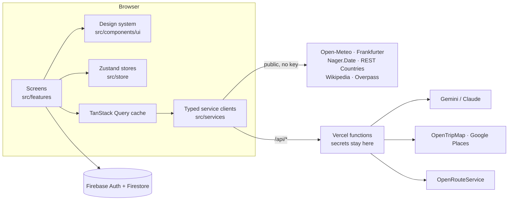

# Voyara

**Other apps make you a plan. Voyara keeps it working** — even when the weather, the crowd, or your
friends change their minds.

A travel-planner PWA built for the 6th International Digital Fest 2027 (Asia Pacific University,
Kuala Lumpur).

> **Status: Milestones 1–5 of 12, plus the app shell** — sign-in, dashboard, trip setup, a swipe
> deck of real places and an AI-built day-by-day plan with a live map. See [Milestones](#milestones).

## Run it

Needs Node 20.19 or newer.

```bash
npm install
npm run dev        # http://localhost:5173
```

| Command             | What it does                                         |
| ------------------- | ---------------------------------------------------- |
| `npm run dev`       | Dev server with hot reload                           |
| `npm run build`     | Type-check, then production build into `dist/`       |
| `npm run preview`   | Serve the production build locally                   |
| `npm run test`      | Unit tests (Vitest + Testing Library)                |
| `npm run lint`      | ESLint, including accessibility rules                |
| `npm run typecheck` | TypeScript in strict mode                            |
| `npm run check`     | Everything above in one go — run before every commit |
| `npm run format`    | Prettier                                             |

Copy `.env.example` to `.env.local`. Nothing is required yet: destination search, rates and the forecast work without keys.

## What works today

Voyara is an app with a public front door:

| Page                 | Who       | What it does                                                         |
| -------------------- | --------- | -------------------------------------------------------------------- |
| `/`                  | Anyone    | Landing: 3D globe, trip bar (where / when / who), destination photos |
| `/login`             | Anyone    | Continue with Google, or as a guest with a name and avatar           |
| `/home`              | Signed in | Dashboard: trip bar, next-trip countdown, stats, your trips, ideas   |
| `/trips`             | Signed in | Every saved trip, upcoming and past                                  |
| `/plan/new`          | Signed in | Trip setup on one screen                                             |
| `/plan/:tripId`      | Signed in | A trip: its details, then the plan being built, then the plan        |
| `/plan/:tripId/pick` | Signed in | Swipe deck: real places to keep, skip or mark as must-do             |
| `/settings`          | Signed in | Account, language, theme, home currency and units                    |
| `/design`            | Anyone    | Every colour, type size and component                                |

Signed-in pages share an app shell: a sidebar on wide screens, a top bar and bottom tab bar on
phones (`src/app/layout/AppLayout.tsx`). Opening one without a profile sends you to sign-in and
back again afterwards.

### From places to a plan

1. **Pick** (`/plan/:tripId/pick`) — `GET /api/places` returns real places around the destination
   from OpenTripMap (OpenStreetMap + Wikipedia data): famous ones first, a mix of categories, each
   with a photo, a short description and a typical visit length. Swipe right to keep, left to
   skip, up for a must-do (or use the buttons or arrow keys). "Pick for me" fills the trip.
2. **Plan** — `POST /api/plan` sends the kept places to the AI planner (Gemini). The AI decides
   **only** which day each place goes on, the order, and a few words (a theme per day, a tip per
   stop, a summary). It can refer to places only by the ids it was given.
3. **Check** — the answer is validated (Zod). Unknown or repeated ids are dropped, missing
   must-dos are added to the nearest day, each day's route is tightened, and **every time and
   travel estimate is computed in code** (`src/planner/optimise.ts`), never by the AI.
4. **Fallback** — if the AI is unavailable, slow or wrong, the built-in planner (group by area →
   nearest-neighbour + 2-opt → schedule) produces the plan instead, on the server or, when offline,
   on the device. The plan page says which one made it.
5. **Use** — day tabs with the forecast, a timeline with travel between stops and a lunch break,
   a live map (MapLibre + MapTiler) with the numbered route, and move / remove on every stop with
   the day re-timed straight away.

The server functions live in `/api` and run on Vercel. `npm run dev` and `npm run preview` run
them too (see `apiRoutes` in `vite.config.ts`), so no extra tool is needed locally. Keys for
OpenTripMap and Gemini are read from `.env.local` on the server side only.

### Loading

The first thing on screen is an opening mark drawn by the browser before any JavaScript arrives
(`index.html`); the app's own page loader is the same mark, so a cold start is one continuous
moment. Moving between pages shows a slim progress bar, photos fade in over a shimmer, and the
map library downloads only when a plan is opened.

### Sign-in

- **Guest** works out of the box and stays on the device.
- **Google** needs Firebase Authentication switched on once: Firebase console → Authentication →
  Get started → Sign-in method → enable **Google**. Later, add your Vercel domain under
  Authentication → Settings → Authorised domains.
- The Firebase SDK is only downloaded when someone taps "Continue with Google".
- Trips are saved on the device for now; syncing them to the account arrives with group mode.

Trip setup is built from custom widgets: a destination autocomplete, a date-range calendar with
a day-and-night strip, a traveller stepper with a line-up of figures, a budget slider with live
conversion to the destination's currency, a pace picker that draws a typical day, and a boarding
pass that fills in as you choose.

### Live data, no key needed

| Data               | Source                                       | Notes                                      |
| ------------------ | -------------------------------------------- | ------------------------------------------ |
| Destination search | Open-Meteo geocoding (GeoNames)              | Falls back to MapTiler if it is down       |
| Exchange rates     | Frankfurter v2                               | Last rates are kept on the device          |
| Forecast           | Open-Meteo, 16 days                          | Daily for now; hourly comes in Milestone 7 |
| Country → currency | Bundled table (`src/lib/countryCurrency.ts`) | Works offline                              |

Every response is validated (`src/services/http.ts`) before the app uses it, with timeouts,
one retry and a typed error, so a failing service shows a clear message instead of breaking a
screen.

### 3D and motion

- The globe (`src/features/landing/globe`) is React Three Fiber with custom shaders: dotted
  continents generated from Natural Earth coastlines, an atmosphere glow, animated flight arcs and
  a pin that drops on the chosen place. Drag to spin it.
- three.js loads only after the page is interactive. Devices without WebGL, with two or fewer CPU
  cores, or in data-saver mode get a still CSS globe instead.
- GSAP ScrollTrigger and Lenis drive the scroll story and load with it, below the fold.
- `prefers-reduced-motion` gives a static globe and fades only.

## Stack

React 18 · TypeScript (strict) · Vite · Tailwind CSS v4 · Framer Motion · React Three Fiber ·
GSAP + Lenis · React Router · Zustand · TanStack Query · i18next · Zod · date-fns · Vitest. Backend: Vercel serverless functions in `/api`
plus Firebase (from Milestone 3 and 8).

## Architecture



The rule that shapes everything: **the AI never invents a place.** It only picks, orders and
explains places that came from a data source, and a deterministic optimiser checks its work.

## Folder structure

```
voyara/
  api/                 Vercel functions (ai, places, route) + prompts      ← Milestone 3+
  public/              favicon, robots.txt, boot.js (pre-paint theme/lang)
  scripts/             seed-curated.ts, build-demo-cache.ts                ← Milestone 10
  src/
    app/               router, providers, layout, error screens, settings sync
    components/ui/     the design system
    features/          one folder per screen (landing, settings, design, …)
    lib/               cn, env, locale helpers, i18n (+ locales/*.json)
    services/          data-source clients                                 ← Milestone 3
    store/             Zustand stores
    styles/            index.css — all design tokens live here
  tests/               unit tests
```

## Design system

Everything visual comes from the tokens at the top of `src/styles/index.css`. Components never
mention a hex value or "dark" — they use utilities such as `bg-surface`, `text-muted`,
`border-line`, and the theme swaps the variables underneath.

- **Colours** — warm paper background, deep tropical green primary, sand-gold accent. Stock
  Tailwind colours are switched off, so nothing off-palette can sneak in.
- **Type** — Fraunces for headlines (`font-display`), Plus Jakarta Sans for UI. Scale:
  12 / 14 / 16 / 20 / 24 / 32 / 48 / 64 (`text-xs` … `text-4xl`).
- **Shape** — radii 10 / 14 / 18 / 24 px, three soft shadow levels.
- **Components** (`src/components/ui`) — Button, IconButton, Chip, Card, Badge, Avatar,
  AvatarGroup, Tabs, Slider, Segmented, Select, Skeleton, Modal, Sheet, Toast.

Two things differ from the original brief, both for accessibility:

- Muted text is `#5F6773`, not `#6B7280`. The original is 4.44:1 on the paper background, just
  under the 4.5:1 WCAG AA needs.
- Each brand colour has an `-ink` partner (`sky-ink`, `accent-ink`, …) for text. Raw sky blue and
  gold are too light to read as text on paper.

`tests/tokens.contrast.test.ts` reads the real values from the CSS and fails if any pairing drops
below AA.

### Accessibility built in

- Modal and Sheet trap focus, close on Escape, return focus to the trigger and make the page
  behind inert.
- Tabs use arrow keys / Home / End, mirrored in right-to-left.
- Slider, Select and Segmented are native inputs underneath.
- `prefers-reduced-motion` is honoured globally: fades only, no movement.

## Languages

English, Malay, Malayalam, Hindi, Arabic (right-to-left) and Tamil.

- Strings live in `src/lib/i18n/locales/<code>.json`. English is bundled; the others load on
  demand, along with the right script font.
- To add a string: add the key to **every** file. `tests/i18n.locales.test.ts` fails if any
  language is missing a key or a `{{placeholder}}`.
- Layout uses logical properties (`ps-`, `pe-`, `start-`, `end-`), so Arabic mirrors without
  special cases.
- The translations were written by an AI. Have a native speaker read each one before the fest.

## Environment variables

See `.env.example` for the full, commented list. In short:

| Variable                                       | Where            | For                            |
| ---------------------------------------------- | ---------------- | ------------------------------ |
| `VITE_FIREBASE_*` (6 values)                   | Browser          | Auth, Firestore                |
| `VITE_MAPTILER_KEY`                            | Browser          | Map tiles, geocoding           |
| `VITE_APP_URL`                                 | Browser          | Share links, QR, Open Graph    |
| `AI_PROVIDER`, `GEMINI_*`, `ANTHROPIC_*`       | Server           | `/api/ai`                      |
| `OPENTRIPMAP_API_KEY`                          | Server           | `/api/places`                  |
| `ORS_API_KEY`                                  | Server           | `/api/route`                   |
| `NOMINATIM_USER_AGENT`                         | Server           | Fallback geocoder              |
| `GOOGLE_PLACES_API_KEY`, `UNSPLASH_ACCESS_KEY` | Server, optional | Richer details, photo fallback |
| `FIREBASE_SERVICE_ACCOUNT`                     | Local only       | Seed script                    |

`VITE_` values ship to the browser and are public by design. The MapTiler key cannot be hidden
(the browser fetches tiles directly), so restrict it to your domains in the MapTiler dashboard.
Everything else stays on the server.

## Data sources and credits

Wired up from Milestone 3. Each will be credited in the place sheet and on a "Data sources" page.

| Data            | Source                                         |
| --------------- | ---------------------------------------------- |
| Maps, geocoding | MapTiler, OpenStreetMap contributors           |
| Places          | OpenTripMap, Overpass API (OpenStreetMap)      |
| Descriptions    | Wikipedia, Wikivoyage                          |
| Photos          | Wikimedia Commons, Unsplash                    |
| Routing         | OpenRouteService                               |
| Weather         | Open-Meteo                                     |
| Currency        | Frankfurter                                    |
| Public holidays | Nager.Date                                     |
| Country basics  | REST Countries (v5) — planned for Milestone 10 |

### Photos and illustrations

- **Featured destination photos** (banners, "Popular destinations", trip cards, sign-in panel) are
  the lead images of each place's Wikipedia article, hosted by Wikimedia. Every one is listed in
  `src/features/destinations/catalog.ts` with its author and licence (CC0, CC BY or CC BY-SA),
  and is credited next to the photo with a link to its file page. To add a destination, add a
  line there with the photo's author and licence — never a photo without them.
- **Any other destination** gets its Wikipedia lead image at run time (`src/services/wiki.ts`),
  credited the same way. If there is no photo, the card falls back to the flag.
- **Illustrations** (`src/components/Scene.tsx`) are original SVGs drawn for Voyara in the app's
  own palette, so they follow light and dark themes.

Fonts: Fraunces, Plus Jakarta Sans and Noto Sans (SIL Open Font License), self-hosted via
Fontsource so they work offline. Icons: Lucide (ISC).

## Deploy

Import the repo in Vercel. `vercel.json` already sets the Vite preset and the single-page-app
rewrite. Add the server variables from `.env.example` in the Vercel dashboard.

## Milestones

1. ✅ Project setup, design system, theming, routing, i18n skeleton, `.env.example`
2. ✅ Landing page with 3D globe and scroll story
3. ✅ Trip setup and data services (places arrive with the swipe deck)
4. ✅ Swipe deck with real places
5. ✅ Plan view: AI planner, optimiser, timeline, map (stops move with buttons; drag comes with
   Milestone 6)
6. Place sheet, budget meter, conflict warnings, AI chat edits
7. Live re-planning and demo controls
8. Group mode (Firestore real-time, QR)
9. Trip-day mode and offline PWA
10. Local smarts panel, curated Malaysia and Kerala data
11. Share page, PDF and calendar export, My trips
12. Polish: animation, accessibility, performance, tests, deploy
